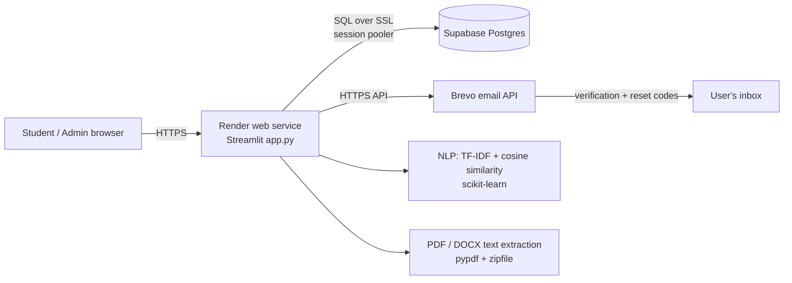

# Architecture

## Main parts of `app.py`
| Area | Responsibility |
|---|---|
| Database layer | short-lived connections, schema creation, row-level security on every table |
| Accounts & security | PBKDF2 hashing, lockout, email verification, reset codes, remember-me tokens, session revocation |
| Analysis logic | alias folding (ML = machine learning), keyword extraction, similarity, audit, ATS format checks |
| Feature logic | A/B compare, roadmap, bullet linting, cover-letter drafting (pure functions, unit tested) |
| Admin | role guard re-checked in the database on every query, k-anonymous analytics, audit log, CSV import |
| UI | Streamlit pages; all user text is escaped before any HTML is rendered |

## Data model
`users` (role, department, token_version, email_verified) → `scans`, `password_resets`, `email_verifications`, `remember_tokens`, `roadmap_progress` (all `ON DELETE CASCADE`); `admin_audit` keeps history with `ON DELETE SET NULL`.

## Request flow: login
1. Form → `authenticate_user` (username or email, lockout, equal-cost hashing for unknown users).
2. Correct password but unverified email → verification screen; otherwise `start_session`.
3. Every page load re-reads role and `token_version` from the database, so a password change or demotion applies immediately.
